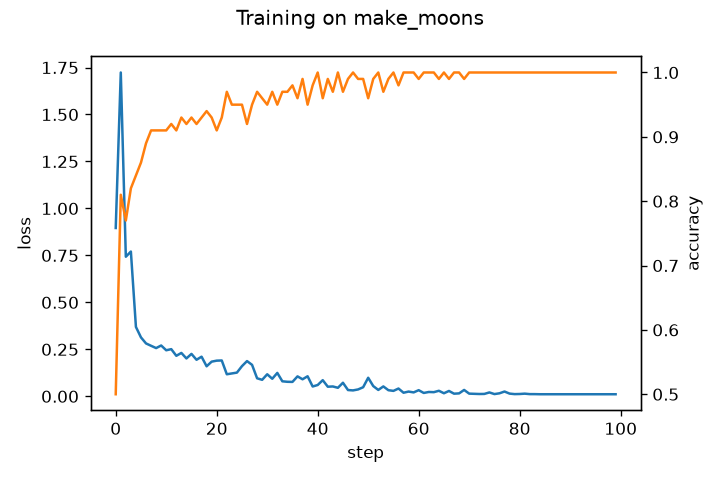
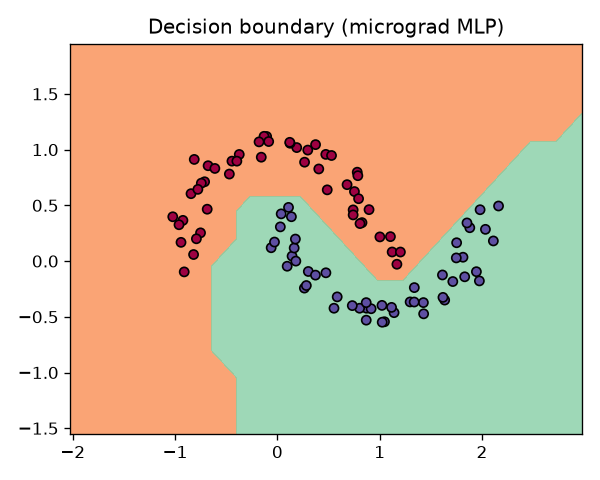

# micrograd — a tiny autograd engine, rebuilt from scratch


A scalar-valued automatic differentiation engine (reverse-mode, like PyTorch's autograd) and a small neural-network library on top of it, written in pure Python.

Built while following Andrej Karpathy's lecture *"The spelled-out intro to neural networks and backpropagation: building micrograd"*, then rewritten and extended on my own.

## What it does

- `Value`: a scalar that records the operations applied to it and builds a computation graph.
- `backward()`: topological sort of the graph, then the chain rule in reverse order.
- Supported operations: `+ - * /`, powers, `relu`, `tanh`, `exp`.
- `nn`: `Neuron`, `Layer`, `MLP`, with `parameters()` and `zero_grad()`.
- `DAG`: draws the computation graph with Graphviz.

## Quick start

```bash
pip install -r requirements.txt
python train.py        # trains an MLP on make_moons, saves plots in assets/
pytest -q              # gradient checks against PyTorch + finite differences
```

## Results

Seed 1337, `make_moons` (100 samples, noise 0.1), SVM max-margin loss + L2, SGD with linear learning-rate decay.

| Model | Parameters | Steps | Final accuracy |
| --- | --- | --- | --- |
| MLP 2-16-16-1 | 337 | 100 | 100 % (training set, 100 samples) |




## How it is tested

- Every operation is compared with **PyTorch autograd** (same expression, same inputs): forward value and gradients must match to 1e-6.
- The chain rule is also checked with **finite differences**, independently of PyTorch.
- Tests run automatically on every push (GitHub Actions).


## Acknowledgements

Based on Andrej Karpathy's [micrograd](https://github.com/karpathy/micrograd) (MIT licence). Some project files (tests, training script, CI) were written with the help of an AI assistant; the engine itself and the analysis are mine.
